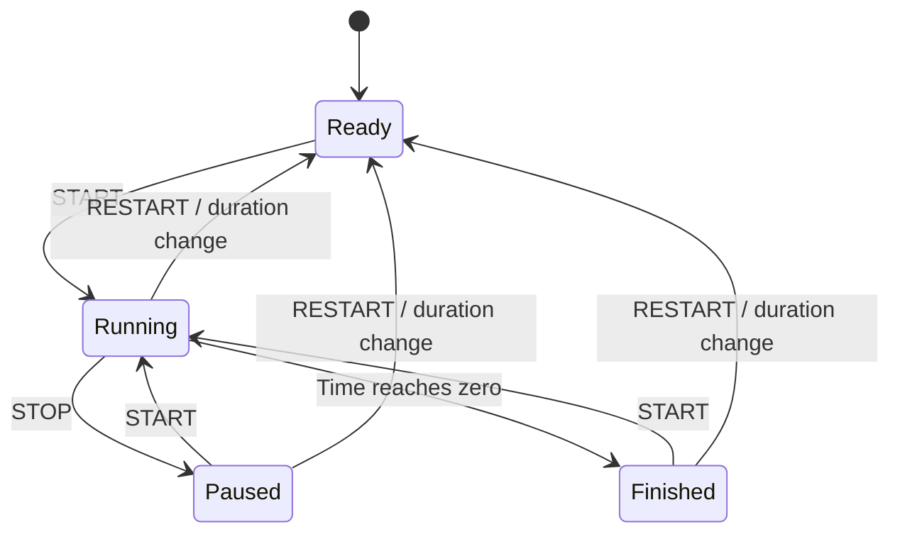

<div align="center">



# SFE VAR Challenge

**A football-inspired countdown experience built for timed challenges.**


</div>

## The experience

SFE VAR Challenge is a browser-based countdown timer with a stadium-inspired visual identity, bold digital typography and animated time-pressure indicators. It provides simple controls for running timed rounds without a backend or application installation.

## Match controls

| Control | Behavior |
| --- | --- |
| Duration | Choose 15, 30, 60 or 120 seconds. |
| START | Begin or resume the countdown. |
| STOP | Pause at the current remaining time. |
| RESTART | Stop the timer and restore the selected duration. |
| Final five seconds | Activate red pulsing and shaking animations. |
| TIME! | Display the end-of-round state and stop automatically. |

Selecting another duration stops the current round and resets the timer. Pressing START after time expires begins a new round using the selected duration.

## Visual identity

<div align="center">


</div>

- Circular digital timer with cyan glow and gold accents.
- Orbitron typography loaded from Google Fonts.
- Football-themed header and side imagery.
- Responsive layout with smaller timer controls and hidden side logos on narrow screens.
- CSS keyframe animations for the critical countdown state.

## Countdown lifecycle



## Technical implementation

The application uses HTML, CSS and vanilla JavaScript in a single page. JavaScript manages the remaining seconds, running state and interval lifecycle. The interface updates every second using `setInterval`, and CSS classes control the critical-state animation.

| File | Purpose |
| --- | --- |
| `index.html` | Application markup, styling and countdown logic |
| `Footballl.png` | Referenced stadium header artwork |
| `Football.png` | Referenced side artwork |
| `docs/countdown-banner.svg` | Animated README illustration |

## Run locally

```bash
git clone https://github.com/RodainaMohamed9/VARCHALENGE.git
cd VARCHALENGE
```

Open `index.html` in a modern browser. No npm installation or build process is required. Internet access is needed to load the external Orbitron font; the timer itself does not require a backend.

## Notes

The animated banner is an illustrative loop, not an interactive timer. The actual timer runs in the application. Browser interval scheduling can drift or be throttled in background tabs, so the implementation is intended for interactive challenge rounds rather than official match timing.

---

<div align="center">

**Every second counts.**

Developed by [Rodaina Mohamed](https://github.com/RodainaMohamed9)

</div>
